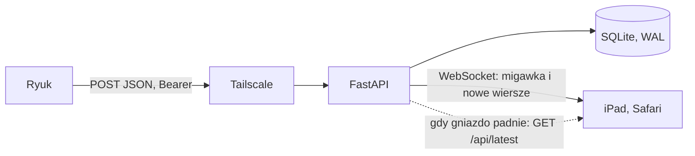

# Pulpit domowy

Ścienny ekran dla iPada w domu. Asystent **Ryuk** co jakiś czas przysyła krótkie podsumowania (kalendarz, przesyłki, poczta, ceny, finanse, AI, GitHub, porządki w skrzynce). Ten program je przyjmuje, dopisuje do SQLite i pokazuje na jednym ciemnym ekranie. iPad otwiera jeden adres, w Safari, dodany do ekranu początkowego, w Dostępie nadzorowanym, z automatyczną blokadą ustawioną na „Nigdy”.

Ryuk **nie łączy się z bazą**. Wysyła JSON przez `POST` po Tailscale (prywatny VPN) z nagłówkiem `Authorization: Bearer <token>`. Serwer najpierw stoi na laptopie, później może przejść na Raspberry Pi.

Wartości w przykładach są fikcyjne: sklepy, numery śledzenia, kwoty, adresy e-mail i nagłówki nie opisują prawdziwych przesyłek ani rachunków.

## Architektura



1. Ryuk składa kopertę `schema_version: 1` dla jednej sekcji.
2. FastAPI sprawdza token (porównanie w czasie stałym), rozmiar ciała i kształt JSON.
3. Nowy wiersz trafia do tabeli `updates`. Ta sama para `section` + `generated_at` nie tworzy drugiego wiersza: serwer zwraca istniejące `id` i nie rozgłasza jej drugi raz.
4. Otwarte WebSockety dostają `{"type":"update","data":...}`. Przy połączeniu dostają migawkę ostatnich wierszy.
5. React rysuje jeden kafelek na sekcję. Nieznana sekcja też się pokazuje, ogólnym kafelkiem.

Odczyt (`GET /api/latest`, `GET /api/section/...`, `/ws`) jest dla sieci LAN albo Tailscale. Opcjonalny `READ_TOKEN` go domyka. `GET /api/health` zostaje otwarty i nie zwraca treści podsumowań.

## Konwencje ze skilli

Repozytorium `https://github.com/gmiszcz/skills` (skille `fastapi-backend` i `react-primereact-frontend`) nie było dostępne z tego środowiska: GitHub zwraca 404. Tam, gdzie brief opisuje kontrakt, endpointy i zachowanie, obowiązuje brief. Poniższe konwencje są świadomym odpowiednikiem tych skilli, a nie cytatem z niedostępnych plików.

Backend:

- pakiet `app` z warstwami `api` (trasy i zależności), `schemas` (Pydantic v2), `services` (zapis i retencja), `repositories` (SQLite);
- konfiguracja przez `pydantic-settings` i plik `.env`, bez sekretów w kodzie;
- modele z `extra="allow"`, żeby nieznane pola przeżyły zapis;
- błędy HTTP w kształcie FastAPI: `401` i `{"detail":"Unauthorized"}`, `413` przy zbyt dużym ciele, `422` przy złym JSON;
- log na stdout (`czas poziom [nazwa] komunikat`). W logu jest sekcja i `id`, nie ma treści maili, kodów odbioru ani tokenów. Access log uvicorn jest wyłączony, bo query string WebSocketa może zawierać `READ_TOKEN`. Własny log zapisuje metodę i ścieżkę bez query;
- testy `pytest` i `TestClient`;
- zależności w `pyproject.toml` oraz `requirements.txt` (Python 3.11+);
- wejście procesu: `python -m app`, które bierze `HOST` i `PORT` z konfiguracji.

Frontend:

- Vite, React 18, TypeScript, PrimeReact 10;
- motyw **Lara Dark Blue** (darmowy). Nowy, komercyjny pakiet `@primereact/ui` wymaga klucza licencji i nie jest używany;
- `PrimeReactProvider`, PrimeFlex, PrimeIcons;
- komponenty PrimeReact: `Card`, `Tag`, `Badge`, `Chip`, `Divider`, `Message`;
- jeden hook `useDashboard` trzyma stan ekranu. WebSocket z ponawianiem i rosnącą przerwą (1 s, 2 s, …, najwyżej 30 s). Gdy gniazdo jest zamknięte, hook odpytuje `GET /api/latest` co 20 s. Osobny globalny store nie jest potrzebny: ekran ma jeden zasób;
- teksty interfejsu po polsku, zegar i daty w strefie `Europe/Warsaw`.

Od tego briefu, świadomie:

- obok indeksu `idx_section_time` jest unikalny indeks `ux_updates_section_generated_at`. Bez niego dwa równoległe POST-y mogłyby wstawić duplikat;
- kolumna `received_at` ma w schemacie domyślne `datetime('now')`. Aplikacja i tak wpisuje własną wartość: czas UTC w ISO 8601 (`2026-10-29T15:10:00+00:00`), żeby klient nie zgadywał strefy;
- `GET /api/health` nie wymaga `READ_TOKEN`.

## Kontrakt danych

Koperta wersji 1, jedna sekcja na żądanie (ścieżka podstawowa):

```json
{
  "schema_version": 1,
  "section": "parcels",
  "generated_at": "2026-10-29T16:00:00+01:00",
  "source": "porz-dki-w-skrzynce",
  "title": "Przesyłki",
  "summary": "1 paczka czeka na odbiór",
  "items": [],
  "extra": {}
}
```

Zasady:

- `schema_version` musi być liczbą `1`. Inna wersja daje `422`.
- `section` to dowolny tekst do 80 znaków, bez ukośników i znaków sterujących. Nieznana sekcja jest przyjmowana i rysowana ogólnie.
- Znaczniki czasu są w ISO 8601 i mają offset `Europe/Warsaw` w tej chwili: `+01:00` zimą (CET) albo `+02:00` latem (CEST). Czas naiwny i czas w UTC (`Z` albo `+00:00`) są odrzucane. Dotyczy to `generated_at`, `sent_at` w paczce oraz pól czasu w pozycjach (`start`, `end`, `deadline`, `valid_from`, `valid_to`, `next_charge`, `date`). Sam dzień `YYYY-MM-DD` jest dozwolony tam, gdzie wydarzenie jest całodzienne.
- Kwoty są liczbami. Waluta jest osobnym polem, zwykle `"PLN"`. Napis `"19,99"` daje `422`.
- Statusy i inne enumeracje są małymi literami, ze stałej listy poniżej. Zły status daje `422`.
- Nieznane pola zostają. Są w obiekcie i w `extra`, także wewnątrz pozycji.
- `items` może być puste.
- `source`, `title` i `summary` są opcjonalne. Kod odbioru przesyłki (`pickup_code`) też jest opcjonalny: pomiń go, jeśli nie chcesz, żeby wisiał na ścianie.

Te same koperty leżą w katalogu `samples/`. Poniższe bloki są ich treścią.

### calendar

Pola pozycji: `start`, `end`, `all_day`, `location`, `calendar`, `changed`.

```json
{
  "schema_version": 1,
  "section": "calendar",
  "generated_at": "2026-10-29T16:00:00+01:00",
  "source": "ryuk-calendar",
  "title": "Kalendarz",
  "summary": "Dziś 2 wydarzenia, jutro wizyta u dentysty",
  "items": [
    {
      "id": "evt-rower",
      "title": "Przegląd roweru",
      "status": "confirmed",
      "start": "2026-10-29T18:30:00+01:00",
      "end": "2026-10-29T19:15:00+01:00",
      "all_day": false,
      "location": "Warsztat Na Kole, ul. Prosta 12, Warszawa",
      "calendar": "prywatny",
      "changed": false
    },
    {
      "id": "evt-kino",
      "title": "Kino: seans fikcyjny",
      "status": "confirmed",
      "start": "2026-10-29T20:15:00+01:00",
      "end": "2026-10-29T22:05:00+01:00",
      "all_day": false,
      "location": "Kino Iluzja, ul. Przykładowa 4, Warszawa",
      "calendar": "wspólny",
      "changed": true
    },
    {
      "id": "evt-dentysta",
      "title": "Dentysta — kontrola",
      "status": "confirmed",
      "start": "2026-10-30T09:40:00+01:00",
      "end": "2026-10-30T10:10:00+01:00",
      "all_day": false,
      "location": "Gabinet Uśmiech, ul. Zielona 8, Warszawa",
      "calendar": "prywatny",
      "changed": false
    },
    {
      "id": "evt-wolne",
      "title": "Dzień wolny (fikcyjny)",
      "status": "confirmed",
      "start": "2026-11-02",
      "end": "2026-11-02",
      "all_day": true,
      "location": "dom",
      "calendar": "prywatny",
      "changed": false
    }
  ],
  "extra": {}
}
```

Kafelek dzieli wydarzenia na „Dziś”, „Jutro” i „Później” według kalendarza warszawskiego. `changed: true` dostaje znacznik „zmienione”.

### email_digest

Pola pozycji: `group`, `from`, `subject`, `note`.

`group`: `subscriptions_finance`, `purchases`, `parcels`, `direct`, `ai_newsletters`.

```json
{
  "schema_version": 1,
  "section": "email_digest",
  "generated_at": "2026-10-29T16:05:00+01:00",
  "source": "ryuk-mail",
  "title": "Poczta",
  "summary": "5 wiadomości wartych uwagi, reszta odłożona",
  "items": [
    {
      "id": "mail-energia",
      "title": "Rozliczenie października",
      "group": "subscriptions_finance",
      "from": "bok@przyklad-energia.example",
      "subject": "Faktura FV/2026/10/1842",
      "note": "Do zapłaty 186,40 zł do 12 listopada"
    },
    {
      "id": "mail-ksiegarnia",
      "title": "Potwierdzenie zamówienia",
      "group": "purchases",
      "from": "sklep@ksiegarnia-fikcja.example",
      "subject": "Zamówienie KF-20441 przyjęte",
      "note": "Dwie książki, wysyłka jutro"
    },
    {
      "id": "mail-paczka",
      "title": "Paczka czeka",
      "group": "parcels",
      "from": "powiadomienia@kurier-fikcja.example",
      "subject": "Przesyłka KF100200300 jest do odbioru",
      "note": "Punkt przy ul. Prostej, do soboty"
    },
    {
      "id": "mail-mama",
      "title": "Wiadomość od rodziny",
      "group": "direct",
      "from": "anna.przyklad@example.com",
      "subject": "Niedziela u nas?",
      "note": "Pyta o godzinę przyjazdu"
    },
    {
      "id": "mail-ai",
      "title": "Newsletter modelowy",
      "group": "ai_newsletters",
      "from": "biuletyn@model-przyklad.example",
      "subject": "Tydzień 44: mały model do etykiet",
      "note": "Krótki, warto przeczytać akapit o lokalnym uruchomieniu"
    }
  ],
  "extra": { "scanned": 86 }
}
```

### parcels

Pola pozycji: `carrier`, `shop`, `pickup_point` (`name`, `address`), `deadline`, `tracking_number`, `status`. Opcjonalnie `pickup_code`.

`status`: `shipped`, `in_transit`, `ready_for_pickup`, `picked_up`, `returned`.

```json
{
  "schema_version": 1,
  "section": "parcels",
  "generated_at": "2026-10-29T16:10:00+01:00",
  "source": "porz-dki-w-skrzynce",
  "title": "Przesyłki",
  "summary": "1 paczka czeka na odbiór",
  "items": [
    {
      "id": "parcel-pickup",
      "title": "Słuchawki półkowe",
      "status": "ready_for_pickup",
      "carrier": "Kurier Fikcja",
      "shop": "Sklep Dźwięk Przykład",
      "pickup_point": { "name": "Punkt WAW-01F", "address": "ul. Prosta 12, Warszawa" },
      "deadline": "2026-10-31T20:00:00+01:00",
      "tracking_number": "KF100200300PL",
      "pickup_code": "482913",
      "url": "https://tracking.example/KF100200300PL"
    },
    {
      "id": "parcel-transit",
      "title": "Filtr do dzbanka",
      "status": "in_transit",
      "carrier": "Kurier Fikcja",
      "shop": "Domowe Przykłady",
      "pickup_point": { "name": "Punkt WAW-01F", "address": "ul. Prosta 12, Warszawa" },
      "deadline": "2026-11-03T18:00:00+01:00",
      "tracking_number": "KF100200301PL",
      "url": "https://tracking.example/KF100200301PL"
    },
    {
      "id": "parcel-shipped",
      "title": "Notes w kratkę",
      "status": "shipped",
      "carrier": "Poczta Fikcja",
      "shop": "Papiernia Przykład",
      "tracking_number": "PF555000111PL",
      "url": "https://tracking.example/PF555000111PL"
    },
    {
      "id": "parcel-picked",
      "title": "Kabel USB-C",
      "status": "picked_up",
      "carrier": "Kurier Fikcja",
      "shop": "Elektronika Przykład",
      "date": "2026-10-28T17:40:00+01:00",
      "tracking_number": "KF100199000PL"
    },
    {
      "id": "parcel-returned",
      "title": "Koszulka, zły rozmiar",
      "status": "returned",
      "carrier": "Kurier Fikcja",
      "shop": "Odzież Przykład",
      "tracking_number": "KF100188000PL",
      "date": "2026-10-27T11:00:00+01:00"
    }
  ],
  "extra": {}
}
```

Druga pozycja nie ma `pickup_code`. Kafelek wysuwa `ready_for_pickup` na górę i pokazuje termin odbioru. Kod pojawia się tylko wtedy, gdy Ryuk go przysłał.

### prices

Pola pozycji: `product`, `store`, `price`, `currency`, `threshold`, `url`, `availability`.

`availability`: `online_delivery`, `in_store`.

```json
{
  "schema_version": 1,
  "section": "prices",
  "generated_at": "2026-10-29T16:12:00+01:00",
  "source": "ryuk-prices",
  "title": "Ceny",
  "summary": "Kawa zeszła poniżej progu",
  "items": [
    {
      "id": "price-kawa",
      "title": "Kawa ziarnista 1 kg",
      "product": "Kawa ziarnista Przykład, 1 kg",
      "store": "Sklep Spożywczy Fikcja",
      "price": 42.9,
      "currency": "PLN",
      "threshold": 45,
      "url": "https://sklep.example/kawa-przyklad-1kg",
      "availability": "online_delivery"
    },
    {
      "id": "price-mleko",
      "title": "Mleko owsiane 1 l",
      "product": "Mleko owsiane Przykład, 1 l",
      "store": "Osiedlowy Fikcja",
      "price": 7.49,
      "currency": "PLN",
      "threshold": 6.5,
      "url": "https://sklep.example/mleko-owsiane",
      "availability": "in_store"
    }
  ],
  "extra": {}
}
```

### promotions

Pola pozycji: `product`, `store`, `price`, `currency`, `valid_from`, `valid_to`, `url`.

```json
{
  "schema_version": 1,
  "section": "promotions",
  "generated_at": "2026-10-29T16:14:00+01:00",
  "source": "ryuk-promotions",
  "title": "Promocje",
  "summary": "Dwie promocje pasują do listy",
  "items": [
    {
      "id": "promo-herbata",
      "title": "Herbata czarna 100 g",
      "product": "Herbata Przykład, 100 torebek",
      "store": "Delikatesy Fikcja",
      "price": 18.99,
      "currency": "PLN",
      "valid_from": "2026-10-27T00:00:00+01:00",
      "valid_to": "2026-11-02T23:59:00+01:00",
      "url": "https://sklep.example/herbata-przyklad"
    },
    {
      "id": "promo-mydlo",
      "title": "Mydło lniane",
      "product": "Mydło lniane Przykład, 3 szt.",
      "store": "Drogeria Fikcja",
      "price": 21,
      "currency": "PLN",
      "valid_from": "2026-10-29T08:00:00+01:00",
      "valid_to": "2026-11-05T21:00:00+01:00",
      "url": "https://sklep.example/mydlo-lniane"
    }
  ],
  "extra": {}
}
```

### subscriptions, expenses_weekly, finance

Te trzy sekcje mają te same pola pozycji: `name`, `amount`, `currency`, `period`, `next_charge`. Sumy i saldo są w `extra`, nie w osobnej tabeli.

```json
{
  "schema_version": 1,
  "section": "subscriptions",
  "generated_at": "2026-10-29T16:16:00+01:00",
  "source": "ryuk-subscriptions",
  "title": "Subskrypcje",
  "summary": "Najbliższe obciążenie w przyszłym tygodniu",
  "items": [
    {
      "id": "sub-muzyka",
      "name": "Muzyka Przykład",
      "amount": 19.99,
      "currency": "PLN",
      "period": "miesiąc",
      "next_charge": "2026-11-04T08:00:00+01:00"
    },
    {
      "id": "sub-chmura",
      "name": "Dysk Przykład 200 GB",
      "amount": 8.99,
      "currency": "PLN",
      "period": "miesiąc",
      "next_charge": "2026-11-12T08:00:00+01:00"
    },
    {
      "id": "sub-prasa",
      "name": "Tygodnik Fikcja",
      "amount": 29,
      "currency": "PLN",
      "period": "miesiąc",
      "next_charge": "2026-11-01T08:00:00+01:00"
    }
  ],
  "extra": { "total": 57.98, "currency": "PLN", "period": "miesiąc" }
}
```

```json
{
  "schema_version": 1,
  "section": "expenses_weekly",
  "generated_at": "2026-10-29T16:18:00+01:00",
  "source": "ryuk-expenses",
  "title": "Wydatki tygodnia",
  "summary": "Tydzień spokojny, największy wydatek to zakupy",
  "items": [
    { "id": "exp-zakupy", "name": "Zakupy spożywcze", "amount": 286.4, "currency": "PLN", "period": "tydzień", "next_charge": "2026-11-02" },
    { "id": "exp-bilet", "name": "Bilety komunikacji", "amount": 54, "currency": "PLN", "period": "tydzień" },
    { "id": "exp-kawa", "name": "Kawiarnia Na Rogu", "amount": 32, "currency": "PLN", "period": "tydzień" }
  ],
  "extra": { "total": 372.4, "currency": "PLN", "week": "2026-W44" }
}
```

```json
{
  "schema_version": 1,
  "section": "finance",
  "generated_at": "2026-10-29T16:20:00+01:00",
  "source": "ryuk-finance",
  "title": "Finanse",
  "summary": "Saldo dodatnie, czynsz schodzi 5 listopada",
  "items": [
    { "id": "fin-czynsz", "name": "Czynsz", "amount": 1850, "currency": "PLN", "period": "miesiąc", "next_charge": "2026-11-05T06:00:00+01:00" },
    { "id": "fin-prad", "name": "Prąd", "amount": 186.4, "currency": "PLN", "period": "miesiąc", "next_charge": "2026-11-12T06:00:00+01:00" },
    { "id": "fin-internet", "name": "Internet", "amount": 69, "currency": "PLN", "period": "miesiąc", "next_charge": "2026-11-08T06:00:00+01:00" }
  ],
  "extra": { "balance": 8420.15, "currency": "PLN", "incoming": 1200, "outgoing": 640.4 }
}
```

### ai_daily, ai_weekly

Pola pozycji: `headline`, `source`, `why_it_matters`, `try_it`, `url`.

```json
{
  "schema_version": 1,
  "section": "ai_daily",
  "generated_at": "2026-10-29T16:22:00+01:00",
  "source": "ryuk-ai-daily",
  "title": "AI dziś",
  "summary": "Jeden temat wart 10 minut",
  "items": [
    {
      "id": "ai-etykiety",
      "headline": "Mały model czyta etykiety słoików",
      "source": "Biuletyn Przykład",
      "why_it_matters": "Da się uruchomić na laptopie i posegregować zdjęcia przetworów bez wysyłania ich poza dom.",
      "try_it": "Zrób zdjęcie jednej etykiety i poproś model tylko o datę i skład.",
      "url": "https://news.example/male-modele-etykiety"
    }
  ],
  "extra": {}
}
```

```json
{
  "schema_version": 1,
  "section": "ai_weekly",
  "generated_at": "2026-10-29T16:24:00+01:00",
  "source": "ryuk-ai-weekly",
  "title": "AI w tym tygodniu",
  "summary": "Dwa wątki, oba lokalne",
  "items": [
    {
      "id": "ai-notatki",
      "headline": "Notatki głosowe zostają w domu",
      "source": "Warsztat Przykład",
      "why_it_matters": "Transkrypcja tygodniowego dyktafonu nie musi iść do chmury.",
      "try_it": "Przepuść jedną dwuminutową notatkę przez lokalny model i porównaj z własnym streszczeniem.",
      "url": "https://news.example/notatki-lokalnie"
    },
    {
      "id": "ai-ogrod",
      "headline": "Kalendarz podlewania z prognozy",
      "source": "Ogród Fikcja",
      "why_it_matters": "Łączy prognozę deszczu z doniczkami na balkonie, bez kolejnej aplikacji.",
      "try_it": "Wypisz rośliny i poproś o plan na 3 dni. Sprawdź, czy pominął sukulenty.",
      "url": "https://news.example/podlewanie"
    }
  ],
  "extra": {}
}
```

### github_weekly

Pola pozycji: `repo`, `version`, `type`, `url`.

`type`: `feature`, `release`, `fix`.

```json
{
  "schema_version": 1,
  "section": "github_weekly",
  "generated_at": "2026-10-29T16:26:00+01:00",
  "source": "ryuk-github",
  "title": "GitHub",
  "summary": "Trzy repozytoria z fikcyjnymi wydaniami",
  "items": [
    { "id": "gh-lampa", "repo": "przyklad/lampa-biurko", "version": "1.4.0", "type": "feature", "url": "https://github.example/przyklad/lampa-biurko/releases/1.4.0" },
    { "id": "gh-notatnik", "repo": "przyklad/notatnik", "version": "0.9.2", "type": "release", "url": "https://github.example/przyklad/notatnik/releases/0.9.2" },
    { "id": "gh-zegar", "repo": "przyklad/zegar-scienny", "version": "2.0.1", "type": "fix", "url": "https://github.example/przyklad/zegar-scienny/releases/2.0.1" }
  ],
  "extra": {}
}
```

### inbox_cleanup

Liczniki `archived` i `left` są w `extra`. Pozycje to wiadomości, które zostały.

```json
{
  "schema_version": 1,
  "section": "inbox_cleanup",
  "generated_at": "2026-10-29T16:28:00+01:00",
  "source": "ryuk-inbox",
  "title": "Porządki w skrzynce",
  "summary": "Archiwum zrobione, zostało kilka wiadomości",
  "items": [
    { "id": "inbox-faktura", "title": "Faktura za prąd", "from": "bok@przyklad-energia.example", "note": "Zostawiona, bo czeka na płatność" },
    { "id": "inbox-rodzina", "title": "Niedziela u nas?", "from": "anna.przyklad@example.com", "note": "Wymaga odpowiedzi" }
  ],
  "extra": { "archived": 42, "left": 7 }
}
```

### Sekcja, której serwer nie zna

Nie trzeba migracji. Wystarczy nowa nazwa:

```json
{
  "schema_version": 1,
  "section": "aquarium",
  "generated_at": "2026-10-29T16:30:00+01:00",
  "source": "ryuk-aquarium",
  "title": "Akwarium",
  "summary": "Temperatura w normie",
  "items": [{ "id": "tank", "title": "Zbiornik w salonie", "temperature_c": 25.4 }],
  "extra": { "room": "salon" }
}
```

Kafelek pokaże tytuł, skrót i listę pozycji. Wyspecjalizowany widok dochodzi później, tylko we froncie.

## Baza

Jedna tabela, tylko dopisywanie. Historia zostaje. Ekran bierze ostatni wiersz każdej sekcji, porównując `generated_at` jako chwilę w czasie (nie jako sam napis, bo offset zmienia się przy zmianie czasu na letni).

```sql
CREATE TABLE updates (
    id INTEGER PRIMARY KEY AUTOINCREMENT,
    section TEXT NOT NULL,
    generated_at TEXT NOT NULL,
    received_at TEXT NOT NULL DEFAULT (datetime('now')),
    schema_version INTEGER NOT NULL,
    title TEXT,
    summary TEXT,
    payload TEXT NOT NULL
);
CREATE INDEX idx_section_time ON updates(section, generated_at);
CREATE UNIQUE INDEX ux_updates_section_generated_at ON updates(section, generated_at);
```

Połączenie włącza WAL (`PRAGMA journal_mode=WAL`), `synchronous=NORMAL` i `busy_timeout=5000`. Plik, `-wal` i `-shm` powstają obok ścieżki `DB_PATH`.

Dlaczego jedna tabela i JSON w `payload`, a nie kolumna na każdy rodzaj przesyłki: nowa sekcja nie wymaga migracji. SQLite umie później liczyć po tym JSON-ie bez zmiany schematu, na przykład:

```sql
SELECT json_extract(payload, '$.extra.total') FROM updates WHERE section = 'subscriptions';
SELECT json_extract(value, '$.status') AS status, COUNT(*)
FROM updates, json_each(updates.payload, '$.items')
WHERE section = 'parcels'
GROUP BY status;
```

`title` i `summary` są też kolumnami, żeby lista ostatnich wierszy nie musiała parsować JSON-a, ale pełna koperta i tak leży w `payload`.

Idempotencja: drugi POST z tą samą sekcją i tym samym `generated_at` (po sprowadzeniu do ISO z offsetem Warszawy, obcięty do sekund) dostaje `200` i istniejące `id`. WebSocket milczy. Ponowienie po padnięciu sieci jest bezpieczne.

Retencja jest opcjonalna. `RETENTION_DAYS=30` usuwa wiersze starsze niż 30 dni, ale **zostawia najnowszy wiersz każdej sekcji**, także gdy jest starszy niż próg. Puste `RETENTION_DAYS` oznacza: trzymaj wszystko. Sprzątanie idzie przy starcie i po każdym nowym wierszu.

## API

Ciało POST jest ograniczone (`MAX_BODY_BYTES`, domyślnie 262144). Większe dostaje `413` i `{"detail":"Payload too large"}`.

| Metoda i ścieżka | Auth | Odpowiedź |
| --- | --- | --- |
| `POST /api/update` | `Authorization: Bearer <DASHBOARD_TOKEN>` | `200 {"id": n}`. `401` zły token, `422` zły JSON |
| `POST /api/updates` | ten sam token zapisu | paczka, patrz niżej. `200 {"ids":[1,2]}` |
| `GET /api/latest` | opcjonalny `READ_TOKEN` | `{"sections":[ ...ostatni wiersz każdej sekcji ]}` |
| `GET /api/section/{name}?limit=N` | opcjonalny `READ_TOKEN` | `{"section","updates"}`. `limit` od 1 do 200, domyślnie 20, najnowsze pierwsze. Pusta sekcja daje pustą listę, nie `404` |
| `GET /api/health` | brak | `{"status","db","updates","stale_after_minutes"}` |
| `GET /` | brak | zbudowany frontend |
| `WS /ws` | opcjonalny `READ_TOKEN` | migawka, potem aktualizacje |

Paczka (opcjonalna; pojedyncze wiadomości są ścieżką podstawową):

```json
{
  "schema_version": 1,
  "sent_at": "2026-10-29T16:40:00+01:00",
  "messages": [ { "schema_version": 1, "section": "parcels", "generated_at": "2026-10-29T16:10:00+01:00", "items": [] } ]
}
```

Cała paczka jest walidowana, zanim cokolwiek zostanie zapisane. Jeden zły element daje `422` i zero nowych wierszy. Po walidacji każdy element jest dopisywany osobno (idempotentnie). Nowe wiersze są rozgłaszane po kolei.

Wiersz zwracany do klienta to koperta plus `id` i `received_at`:

```json
{
  "type": "update",
  "data": {
    "id": 4,
    "received_at": "2026-10-29T15:10:05+00:00",
    "schema_version": 1,
    "section": "parcels",
    "generated_at": "2026-10-29T16:10:00+01:00",
    "title": "Przesyłki",
    "summary": "1 paczka czeka na odbiór",
    "items": [],
    "extra": {}
  }
}
```

WebSocket:

- zaraz po połączeniu: `{"type":"snapshot","data":[ ...jak GET /api/latest ]}`;
- każdy nowy wiersz: `{"type":"update","data":<koperta + id>}`;
- co 25 s, gdy klient milczy: `{"type":"ping"}` (zostawione, żeby NAT nie uciął gniazda);
- zły `READ_TOKEN` zamyka gniazdo kodem `1008`.

`READ_TOKEN` można podać nagłówkiem `Authorization: Bearer ...` albo query `?token=`. iPad nie ustawi nagłówka na WebSockecie, więc strona czyta `?token=` z adresu, zapisuje go w `localStorage` i usuwa z paska adresu. Potem dokleja go do `/ws` i do `GET`.

Kafelek dostaje znacznik „nieaktualne”, gdy `generated_at` jest starsze niż `STALE_AFTER_MINUTES` (domyślnie 360). Próg przychodzi z `/api/health`, więc zmiana `.env` nie wymaga przebudowy frontu.

Gdy przeglądarka umie, strona prosi o [Screen Wake Lock](https://developer.mozilla.org/en-US/docs/Web/API/Screen_Wake_Lock_API). Na iPadzie i tak ustaw automatyczną blokadę na „Nigdy”: Wake Lock działa tylko, gdy Safari jest na wierzchu, a Dostęp nadzorowany bywa pewniejszy.

## Konfiguracja

Skopiuj `.env.example` do `.env`. Plik `.env` jest w `.gitignore`.

| Zmienna | Znaczenie |
| --- | --- |
| `DASHBOARD_TOKEN` | token Ryuka, minimum 8 znaków |
| `DB_PATH` | plik SQLite. Ścieżka względna jest liczona od katalogu repozytorium |
| `HOST` | adres nasłuchu. Na produkcji lepiej adres Tailscale (`100.x.y.z`) niż `0.0.0.0` |
| `PORT` | port, domyślnie `8000` |
| `READ_TOKEN` | puste = odczyt otwarty w sieci, w której stoi serwer |
| `RETENTION_DAYS` | puste = bez usuwania historii |
| `MAX_BODY_BYTES` | limit ciała POST |
| `STALE_AFTER_MINUTES` | po ilu minutach kafelek jest „nieaktualne” |
| `LOG_LEVEL` | `DEBUG`, `INFO`, `WARNING`, `ERROR`, `CRITICAL` |

Token wygenerujesz tak:

```bash
python3 -c "import secrets; print(secrets.token_urlsafe(32))"
```

## Laptop

Potrzebne: Python 3.11+ i Node 20+ (do zbudowania frontu).

```bash
python3 -m venv .venv
source .venv/bin/activate
pip install -r requirements.txt
cp .env.example .env
# wpisz DASHBOARD_TOKEN

cd frontend
npm install
npm run build
cd ..

python -m app
```

iPad i Ryuk wchodzą na `http://<adres>:8000`. Sam interfejs w czasie pracy nad kafelkami:

```bash
# terminal 1
python -m uvicorn app.main:app --reload --host 127.0.0.1 --port 8000
# terminal 2
cd frontend && npm run dev
```

Vite na `http://127.0.0.1:5173` przekazuje `/api` i `/ws` do backendu. Zbudowany `frontend/dist` serwuje sam FastAPI, więc na ścianie jest jeden adres, bez Vite.

Testy i próbki:

```bash
pip install -r requirements-dev.txt
pytest
DASHBOARD_TOKEN=... python3 scripts/send_sample.py --fresh
```

`--fresh` przesuwa znaczniki z plików tak, żeby `generated_at` było „teraz” w Warszawie, a wydarzenia zostały w tych samych odstępach. Bez tej flagi idą daty zapisane w `samples/`. `--batch` wysyła jeden `POST /api/updates`. `--only parcels` wysyła jedną sekcję. Token bierz ze zmiennej `DASHBOARD_TOKEN`. `--token` zostawia sekret w liście procesów.

## Raspberry Pi

Raspberry Pi OS 64-bit (arm64), Python 3.11 albo nowszy. Node na Pi bywa stary. Najprościej zbudować frontend na laptopie i skopiować katalog `frontend/dist` razem z resztą repozytorium. Obraz Dockera buduje front sam i działa na arm64.

```bash
sudo apt update
sudo apt install -y python3 python3-venv python3-pip
sudo mkdir -p /opt/home-dashboard
sudo chown "$USER:$USER" /opt/home-dashboard
# z laptopa, po npm run build:
rsync -a --exclude .venv --exclude frontend/node_modules ./ pi@<tailscale-ip>:/opt/home-dashboard/

ssh pi@<tailscale-ip>
cd /opt/home-dashboard
python3 -m venv .venv
.venv/bin/pip install -r requirements.txt
cp .env.example .env
nano .env   # DASHBOARD_TOKEN, HOST=100.x.y.z adresu Tailscale tego Pi
```

Jednostka systemd jest w `deploy/home-dashboard.service`. Domyślny użytkownik to `pi`. Na innym koncie popraw `User`, `Group` i ścieżki.

```bash
sudo cp deploy/home-dashboard.service /etc/systemd/system/home-dashboard.service
sudo systemctl daemon-reload
sudo systemctl enable --now home-dashboard.service
systemctl status home-dashboard.service
journalctl -u home-dashboard.service -f
```

Proces czyta `.env` i woła `python -m app`, więc `HOST` i `PORT` z pliku naprawdę obowiązują. `Restart=on-failure` podnosi proces po błędzie.

Aktualizacja:

```bash
# na laptopie: npm run build, potem rsync jak wyżej
ssh pi@<tailscale-ip> 'sudo systemctl restart home-dashboard.service'
```

`index.html` ma `Cache-Control: no-cache`, więc iPad po restarcie usługi powinien wziąć nowy plik. Gdy kafelek wygląda po staremu, odśwież Safari.

## Docker

Opcjonalnie, ten sam plik na laptopie i na Pi (obraz wieloarchitekturowy):

```bash
cp .env.example .env
docker compose up -d --build
```

Compose nadpisuje `DB_PATH=/data/dashboard.sqlite` i trzyma plik w wolumenie `dashboard-data`. Publikacja `8000:8000` otwiera port na wszystkich interfejsach hosta. Żeby zostać przy Tailscale, ustaw w compose port na adres tailneta, na przykład `100.x.y.z:8000:8000`, i nie wystawiaj tej usługi w `tailscale funnel`.

## Tailscale

1. Zainstaluj Tailscale na laptopie albo na Pi i na iPadzie. Zaloguj je do tego samego tailnetu.
2. `tailscale ip -4` pokaże adres `100.x.y.z`. Wpisz go jako `HOST`, żeby proces nie słuchał na publicznym interfejsie.
3. iPad w Safari: `http://100.x.y.z:8000`.
4. Ryuk z innej maszyny w tailnecie wysyła POST na ten sam adres.
5. Nie włączaj Funnel. Funnel publikuje usługę w internecie. MagicDNS (`http://nazwa.twoj-tailnet.ts.net:8000`) jest wygodny i zostaje wewnątrz tailnetu.
6. Jeśli kiedyś postawisz HTTPS (Tailscale Serve), strona sama przełączy WebSocket na `wss`.

Sieć domowa bez Tailscale też działa: `HOST` ustaw na adres LAN i trzymaj port zamknięty na routerze. Tailscale jest po to, żeby Ryuk i iPad widzieli serwer także poza domowym Wi-Fi, bez otwierania portu.

## iPad

1. Tailscale na iPadzie, połączony z tym samym tailnetem.
2. Ustawienia → Ekran i jasność → Automatyczna blokada → **Nigdy**. iPad podłączony do zasilania.
3. Safari → `http://100.x.y.z:8000`. Gdy ustawiłeś `READ_TOKEN`, pierwszy adres to `http://100.x.y.z:8000/?token=...`. Strona zapamięta token i schowa go z paska.
4. Udostępnij → Do ekranu początkowego. Nazwa: Pulpit.
5. Ustawienia → Dostępność → Dostęp nadzorowany → włącz, ustaw kod.
6. Otwórz ikonę Pulpit (nie kartę Safari). Potrójne kliknięcie bocznego przycisku uruchamia Dostęp nadzorowany. Wyłącz obszary, których nie chcesz (pasek gestów).
7. W nagłówku widać datę po polsku, zegar warszawski, stan „na żywo” i „ekran aktywny”, gdy Wake Lock się udał. Brak „ekran aktywny” nie jest awarią: na części iPadów zostaje sama blokada systemowa.
8. „Odpytywanie” oznacza, że WebSocket spadł i strona co 20 s woła `/api/latest`, a w tle próbuje połączyć się z powrotem.

Ekran jest poziomy: nagłówek na całą szerokość, kafelki w dwóch kolumnach. Kalendarz i poczta biorą szeroki wiersz.

## Bezpieczeństwo

- `DASHBOARD_TOKEN` i `READ_TOKEN` żyją tylko w `.env` albo w magazynie sekretów procesu. Nie commituj ich i nie wklejaj do jednostek systemd na sztywno. Jednostka czyta `EnvironmentFile`.
- Porównanie tokenu idzie po skrócie SHA-256 i `secrets.compare_digest`, więc długość sekretu nie wynika z czasu odpowiedzi. Zły i pusty token dają ten sam `401`.
- Zapis wymaga tokenu zawsze. Odczyt jest otwarty tylko wtedy, gdy `READ_TOKEN` jest pusty, i tylko dla tego, kto dosięgnie portu. Dlatego `HOST` ma być adresem Tailscale albo LAN, a port nie ma być przekierowany z internetu.
- Logi nie zawierają ciał podsumowań. Mimo to plik SQLite zawiera maile, terminy i — jeśli Ryuk je wyśle — kody odbioru. Chroń plik jak skrzynkę: uprawnienia katalogu `data/`, kopia tylko na zaufany dysk.
- `pickup_code` jest opcjonalny właśnie po to, żeby dało się go nie wysyłać.
- Limit ciała ucina przypadkowy albo złośliwy duży POST.

## Testy

```bash
pip install -r requirements-dev.txt
pytest
cd frontend && npm run build
```

`pytest` sprawdza: brak i zły token, token odczytu (health zostaje otwarty), limit ciała, odrzucenie czasu bez offsetu Warszawy i złego statusu, zachowanie nieznanych pól, dopisanie i ostatni wiersz, historię, idempotencję, paczkę, odrzucenie całej paczki bez zapisu, retencję z zostawieniem najnowszego wiersza, WAL i nazwy kolumn oraz indeksów, wszystkie pliki `samples/`, migawkę WebSocketa i rozgłoszenie nowego wiersza.

Build frontu to `tsc -b` i `vite build`.

Próbki na działający serwer:

```bash
export DASHBOARD_TOKEN=...          # taki jak w .env
export DASHBOARD_URL=http://127.0.0.1:8000
python3 scripts/send_sample.py --fresh
```

## curl i websocat

Zapis jednej sekcji:

```bash
curl -sS -X POST http://127.0.0.1:8000/api/update \
  -H "Authorization: Bearer $DASHBOARD_TOKEN" \
  -H "Content-Type: application/json" \
  --data-binary @samples/parcels.json
```

Paczka:

```bash
python3 - << 'PY' | curl -sS -X POST http://127.0.0.1:8000/api/updates \
  -H "Authorization: Bearer $DASHBOARD_TOKEN" \
  -H "Content-Type: application/json" \
  --data-binary @-
import json
from pathlib import Path
messages = [json.loads(p.read_text()) for p in sorted(Path("samples").glob("*.json"))]
print(json.dumps({
    "schema_version": 1,
    "sent_at": "2026-10-29T16:40:00+01:00",
    "messages": messages,
}, ensure_ascii=False))
PY
```

Odczyt:

```bash
curl -sS http://127.0.0.1:8000/api/health
curl -sS http://127.0.0.1:8000/api/latest
curl -sS "http://127.0.0.1:8000/api/section/parcels?limit=5"
# gdy READ_TOKEN jest ustawiony:
curl -sS http://127.0.0.1:8000/api/latest -H "Authorization: Bearer $READ_TOKEN"
```

WebSocket (`websocat`):

```bash
websocat ws://127.0.0.1:8000/ws
# z tokenem odczytu:
websocat "ws://127.0.0.1:8000/ws?token=$READ_TOKEN"
```

Pierwsza ramka to `snapshot`. Zostaw proces włączony i w drugim terminalu wyślij `scripts/send_sample.py`: przyjdzie ramka `update`.

## Nowa sekcja

1. Ryuk wysyła kopertę z nową nazwą `section`. Serwer ją przyjmie. Baza się nie zmienia.
2. Ekran pokaże kafelek ogólny: tytuł, skrót, pozycje z `title` / `status` / `date`.
3. Żeby dodać własny widok, dopisz komponent w `frontend/src/renderers/` i zarejestruj go w `frontend/src/renderers/index.tsx`. Kolejność i ikonę ustaw w `frontend/src/sections.ts`.
4. Jeśli sekcja ma własne enumeracje (jak status przesyłki), dopisz je w `app/schemas/sections.py`, żeby literówka dostała `422` zamiast cichego wyświetlenia. Potem przebuduj front (`npm run build`) i zrestartuj proces.
5. Dołóż `samples/<sekcja>.json`. Test `tests/test_samples.py` wymaga, żeby każdy plik z tego katalogu przeszedł `POST /api/update`. Nowa sekcja w tym teście musi trafić do zbioru `EXPECTED` albo test trzeba świadomie rozszerzyć.

Nie twórz drugiej tabeli. Nowe pola trzymaj w pozycji albo w `extra`. `json_extract` i `json_each` wystarczą do późniejszych podsumowań.
