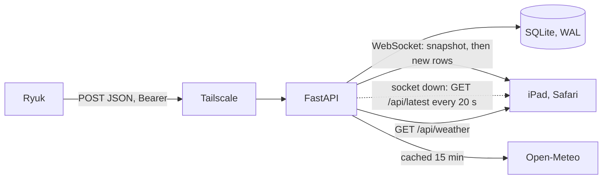

# Home Dashboard

A wall-mounted screen for an iPad at home. The assistant **Ryuk** periodically sends short summaries (calendar, parcels, mail, prices, finance, AI news, GitHub releases, inbox cleanup). This service accepts them, appends them to SQLite and shows them on one dark screen, together with a weather forecast for Gliwice. The iPad opens a single URL in Safari, added to the home screen and locked with Guided Access.

Ryuk **never talks to the database**. It sends JSON with `POST` over Tailscale (private VPN) with an `Authorization: Bearer <token>` header. The server runs on a laptop for development and in Docker on a Raspberry Pi Zero 2 W in production.

The dashboard UI is in Polish. Code, comments and documentation are in English. All values in the samples are fictional.

## Architecture



1. Ryuk builds an envelope (`schema_version` 1 or 2) for one section.
2. FastAPI checks the token (constant-time comparison), the body size and the JSON shape.
3. A new row goes into the `updates` table. The same `section` + `generated_at` pair never creates a second row: the server returns the existing `id` and does not broadcast it again.
4. Open WebSockets receive `{"type":"update","data":...}`. On connect they receive a snapshot of the latest rows.
5. React draws one tile per section. An unknown section is shown too, with a generic tile.

| Layer | Path | Responsibility |
| --- | --- | --- |
| Entry point | `app/__main__.py`, `app/main.py` | uvicorn (h11), lifespan (migration, retention), static frontend |
| Auth | `app/auth.py`, `app/api/deps.py` | ingest token always required, optional read token |
| Middleware | `app/middleware.py` | body size limit (`413`), access log without query string |
| Validation | `app/schemas/` | envelope model, Warsaw offsets, per-section field and enum rules |
| Storage | `app/repositories/updates.py` | one append-only table, idempotent insert, retention |
| Realtime | `app/services/hub.py`, `app/api/routes/ws.py` | snapshot, broadcast, heartbeat |
| Weather | `app/services/weather.py` | Open-Meteo forecast for Gliwice, 15-minute in-memory cache |
| Frontend | `frontend/src/` | Vite, React 18, TypeScript, PrimeReact 10 (Lara Dark Blue) |

## Dashboard features

- **Header**: Polish date, Warsaw clock, a 5-slot weather timeline, a connection LED and the view toggle.
- **Connection LED**: green = live WebSocket, amber = polling `GET /api/latest` every 20 s (the socket is down and reconnects in the background with backoff 1 s, 2 s, ... up to 30 s), pulsing amber = connecting, red = offline.
- **Simple view** (default): only what matters today. Today's calendar events (tomorrow's after 18:00), parcels still in progress, the daily AI item, family events in the next 30 days, and anything the sender marks with `simple: true`. Larger type for reading across the room.
- **Full view**: every section. Tiles can be dragged (mouse or touch) and widened to full width. Order and widths are stored in `localStorage` and can be reset from the footer.
- **Układ dnia** (on by default, footer toggle): before 12:00 Warsaw time the default order leads with calendar and AI dziś; from 18:00 it leads with parcels and calendar (tomorrow's events in the simple view). A saved drag order is left as-is. Resetting the layout returns to the time-of-day order.
- **New content first** (full view only): a tile whose summary or items changed since you last acknowledged it gets a green frame, a "nowe" tag and an "Ogarnięte" button, and moves to the top (newest first). Clicking the button stores the acknowledged content in `localStorage` (`dashboard_seen_content`) and the tile animates back to its own place. A resend with only a new `generated_at`, or an empty update, does not count as new. On the first run on a device everything already on screen counts as acknowledged.
- **Data-age LED**: every tile has a small LED next to its title, based on `generated_at`. Green means the data is from today (Europe/Warsaw), orange means an earlier day but less than 24 h old, red means more than 24 h old. Hover shows a Polish label. The thresholds are fixed in the frontend, there is no setting.
- **Animations**: tiles slide to their new position when the order changes, new tiles and rows fade in, a tile pulses briefly when its content changes. Timings are CSS variables at the top of `frontend/src/index.css`. Disabled with the system "reduce motion" setting.
- **Self-refresh**: the page reloads when `/api/health` reports a new `server_id` (server restart or update). Once a night it also reloads at the first health check after 04:00, but only when the page was loaded before that 04:00. The reload happens once per night and never in a loop.
- **Screen Wake Lock** is requested when the browser supports it. Set Auto-Lock to "Never" on the iPad anyway, because Wake Lock only works while Safari is in front.

## Quick start (laptop)

Requirements: Python 3.11+, [uv](https://docs.astral.sh/uv/), Node 20+ and [just](https://github.com/casey/just).

```bash
just install          # uv sync --extra dev, npm install, creates .env from .env.example
# put a DASHBOARD_TOKEN into .env
just dev              # FastAPI on :8000 and Vite on :5173 in parallel
just sample           # send a random set of sample data
```

Vite on `http://127.0.0.1:5173` proxies `/api` and `/ws` to the backend. The built `frontend/dist` is served by FastAPI itself, so production is a single URL without Vite.

| Recipe | What it does |
| --- | --- |
| `just install` | install backend and frontend dependencies, create `.env` |
| `just dev` | backend with reload + Vite dev server |
| `just dev-backend` / `just dev-frontend` | one of the two |
| `just build` | production frontend build into `frontend/dist` |
| `just run` | production server (`python -m app`, reads `HOST` and `PORT`) |
| `just lint` | ruff lint and format check |
| `just fix` | ruff auto-fix and format |
| `just test` | pytest only |
| `just check-backend` | ruff, mypy, bandit, pytest |
| `just check-frontend` | `tsc -b`, vitest, production build |
| `just check` | both checks above, the same set CI runs |
| `just docker` | build the image on this machine and start it (`docker-compose.dev.yml`) |
| `just check-pi-deps` | aarch64 wheels for runtime dependencies (needs network). `linux/arm/v7` is checked by the CI image build |
| `just sample` | random envelopes from `samples/pool/` |
| `just sample-static` | fixed envelopes from `samples/*.json`, shifted to now |

Without `just`: `uv sync --extra dev`, `npm --prefix frontend install`, `npm --prefix frontend run build`, `uv run python -m app`.

Generate a token with:

```bash
python3 -c "import secrets; print(secrets.token_urlsafe(32))"
```

## Configuration

Copy `.env.example` to `.env`. `.env` is git-ignored. Compose and `scripts/auto-update.sh` also read `DASHBOARD_TAG`, `AUTO_UPDATE_BUILD_LOCALLY` and `NODE_OPTIONS` from that file. Those are described under Deployment and are not application settings.

| Variable | Default | Meaning |
| --- | --- | --- |
| `DASHBOARD_TOKEN` | none, required | Ryuk's ingest token, at least 8 characters |
| `DB_PATH` | `data/dashboard.sqlite` | SQLite file. A relative path is resolved from the repository root. Compose sets `/data/dashboard.sqlite` |
| `HOST` | `0.0.0.0` | listen address. Compose sets `0.0.0.0`. In production prefer the Tailscale address (`100.x.y.z`) |
| `PORT` | `8000` | port. Compose also uses it for the published port and the health check |
| `READ_TOKEN` | empty | empty = reads are open to whoever reaches the port |
| `RETENTION_DAYS` | empty (keep everything) | deletes rows older than N days, the newest row of each section stays. On the Pi `90` bounds disk use |
| `MAX_BODY_BYTES` | `262144` | POST body limit in bytes, 1024 to 5000000 |
| `STALE_AFTER_MINUTES` | `360` | only reported by `/api/health` as `stale_after_minutes`. The tile LED does not use it |
| `LOG_LEVEL` | `INFO` | `DEBUG`, `INFO`, `WARNING`, `ERROR`, `CRITICAL` |
| `STATIC_DIR` | `frontend/dist` | built frontend served at `/`. A relative path is resolved from the repository root. If the directory is missing, the server runs as API only |

## Data contract

One section per request (the primary path):

```json
{
  "schema_version": 1,
  "section": "parcels",
  "generated_at": "2026-10-29T16:00:00+01:00",
  "source": "ryuk-mail",
  "title": "Przesyłki",
  "summary": "1 paczka czeka na odbiór",
  "items": [],
  "extra": {}
}
```

Rules:

- `schema_version` is `1` or `2`. Any other value is rejected with `422`.
- `section` is free text up to 80 characters, without slashes or control characters. An unknown section is accepted and drawn with the generic tile.
- Timestamps are ISO 8601 with the Europe/Warsaw offset valid at that instant: `+01:00` in winter (CET), `+02:00` in summer (CEST). Naive times and UTC (`Z`, `+00:00`) are rejected. This applies to `generated_at`, the batch `sent_at` and item time fields (`start`, `end`, `deadline`, `valid_from`, `valid_to`, `next_charge`, `date`). A plain `YYYY-MM-DD` date is allowed in item fields for all-day events.
- Amounts are numbers. The currency is a separate field, usually `"PLN"`. A string like `"19,99"` gives `422`. When `price` or `amount` is set, `currency` is required.
- Statuses and other enums are lowercase and come from the fixed lists below. A wrong value gives `422`.
- Unknown fields are kept, both on the envelope and inside items.
- `items` may be empty (at most 100). `source`, `title` and `summary` are optional.
- Titles and labels sent by Ryuk are shown as-is, so they are written in Polish.

### Display hints (schema_version 2)

Version 2 adds optional hints for the frontend. They are stored like any other field.

| Field | Where | Effect |
| --- | --- | --- |
| `display.collapsed` | envelope | tile starts collapsed |
| `display.max_visible` | envelope | rows shown before "Pokaż jeszcze", `0` = all |
| `display.sort` | envelope | `priority` (default) or `time` |
| `display.simple` | envelope | force the section in or out of the simple view |
| `priority` | item | `high` / `urgent` / `critical`, `normal` / `medium`, `low` |
| `pinned` | item | sorted first and highlighted |
| `simple` | item | show this item in the simple view |

### Known sections

Complete examples live in `samples/*.json`. `docs/example.json` is the full reference for Ryuk: one `POST /api/updates` batch with every known section, the calendar in the `days_plus_week` layout. Each entry in `messages` can also be sent alone to `POST /api/update`.

| Section | Item fields | Enums and extras |
| --- | --- | --- |
| `calendar` | `start`, `end`, `all_day`, `location`, `calendar`, `changed` | grouped into Dziś / Jutro / Później by the Warsaw calendar, `changed: true` shows "zmienione" |
| `email_digest` | `group`, `from`, `subject`, `note` | `group`: `subscriptions_finance`, `purchases`, `parcels`, `direct`, `ai_newsletters`. `extra.scanned` |
| `parcels` | `carrier`, `shop`, `pickup_point` (`name`, `address`), `deadline`, `tracking_number`, `status`, optional `pickup_code` | `status`: `shipped`, `in_transit`, `ready_for_pickup`, `picked_up`, `returned`. `ready_for_pickup` is sorted first and shows a live countdown |
| `prices` | `product`, `store`, `price`, `currency`, `threshold`, `url`, `availability` | `availability`: `online_delivery`, `in_store`. Sparkline from `extra.history` |
| `promotions` | `product`, `store`, `price`, `currency`, `valid_from`, `valid_to`, `url`, optional `image` | card with `valid_to`; image is omitted when missing or not http(s). "Pomiń" marks an item as `skipped` (item key: `id`, else `url`, else `product` + `store`). Skipped items are hidden unless the header checkbox "Pominięte" is on (stored per device in `localStorage`) |
| `subscriptions` | `name`, `amount`, `currency`, `period`, `next_charge` | `extra.total`, `currency`, `period`, `next_30_days` |
| `expenses_weekly` | `name`, `amount`, `currency`, `date`, `category` | chart `extra`: `total`, `by_category`, `by_day`, `previous_week`, `diff_vs_previous`. Older payloads without those stay a list |
| `finance` | `name`, `amount`, `currency`, `period`, `next_charge`, optional `direction` (`in` / `out`) | `extra.balance`, `incoming`, `outgoing`, `budget` (null hides the budget bar), `forecast_outgoing`, `by_day` |
| `family_events` | `title`, `date`, `location`, `note`, `priority`, `simple` | countdown in days. Tile title comes from the envelope, for example `Maja` |
| `ai_daily`, `ai_weekly` | `headline`, `source`, `why_it_matters`, `try_it`, `url` | Every item has a "Przeczytane" button and an undo. Read items sort after unread ones and the next unread item becomes the top one. The mark is stored per item in the `acks` table, keyed by `id`, else `url`, else `headline` / `title` (first 200 characters), so send a stable `id`. Marks survive a re-post of the section. Send only today's items to `ai_daily` and the cumulative week to `ai_weekly` |
| `github_weekly` | `repo`, `version`, `type`, `url` | `type`: `feature`, `release`, `fix` |
| `inbox_cleanup` | `title`, `from`, `note` (messages that remain) | `extra.archived`, `extra.left` (numbers) |

`pickup_code` is optional on purpose: leave it out if it should not hang on the wall.

### Calendar: days plus week

The preferred calendar payload uses `layout: "days_plus_week"` with `days` and `week` instead of `items` (reference example for Ryuk: the `calendar` message in `docs/example.json`). The tile shows three columns on the left (usually Dziś, Jutro, Pojutrze) and a list of the following 7 days on the right. The simple view and the full view show the same calendar.

| Field | Rules |
| --- | --- |
| `layout` | `days_plus_week` |
| `days[]` | at most 7. `date` (`YYYY-MM-DD`, required), `label` (column title, defaults to the date), `events[]` |
| `week` | optional. `from` and `to` (`YYYY-MM-DD`, `from` ≤ `to`), `events[]` |
| event | `start` (required), `end`, `all_day`, `title`, `location`, `calendar`, `provider` (`google` or `icloud`), `color` (`#RGB`, `#RRGGBB` or `#RRGGBBAA`), `priority`, `simple`, `changed` |

Events in `days` and `week` share the same shape. The Warsaw date of `start` must equal the day's `date`, or fall within `week.from`..`week.to`. Anything else gives `422`. Send `color` as set in the phone's calendar. Without it the tile picks a fixed color per `calendar` + `provider`, which will not match the phone. `priority: "high"` shows "ważne". The old `items` calendar is still accepted and drawn as before.

### Unknown section

No migration is needed. A new name is enough:

```json
{
  "schema_version": 1,
  "section": "aquarium",
  "generated_at": "2026-10-29T16:30:00+01:00",
  "title": "Akwarium",
  "summary": "Temperatura w normie",
  "items": [{ "id": "tank", "title": "Zbiornik w salonie", "temperature_c": 25.4 }],
  "extra": { "room": "salon" }
}
```

The generic tile shows the title, the summary and the items (`title` / `status` / `date`).

## API

| Method and path | Auth | Response |
| --- | --- | --- |
| `POST /api/update` | `Authorization: Bearer <DASHBOARD_TOKEN>` | `200 {"id": n}`. `401` bad token, `413` body too large, `422` invalid JSON |
| `POST /api/updates` | same ingest token | batch, see below. `200 {"ids": [1, 2]}` |
| `GET /api/latest` | optional `READ_TOKEN` | `{"sections": [...latest row of every section]}` |
| `GET /api/section/{name}?limit=N` | optional `READ_TOKEN` | `{"section", "updates"}`, newest first. `limit` 1 to 200, default 20. An empty section gives an empty list, not `404` |
| `GET /api/ack?section=<name>` | ingest token (`Authorization: Bearer <DASHBOARD_TOKEN>`) | `{"section", "acks": [...]}` with every per-item mark stored for that section (`section`, `item_id`, `acked_at`, plus any other mark fields). Ryuk calls it before posting an update, so the update does not overwrite marks such as read items in `ai_daily` and `ai_weekly` or hidden items in `promotions`. Any known section works. `401` bad token, `422` missing or unknown `section`. A known section without marks gives an empty list |
| `GET /api/weather` | none | `{"city", "current", "hourly", "updated_at"}` for Gliwice. `503` when Open-Meteo is unreachable and nothing is cached |
| `GET /api/health` | none | `{"status", "db", "updates", "stale_after_minutes", "server_id", "version"}` |
| `POST /api/ack` | `READ_TOKEN` when set | body `{"section", "item_id", "kind"}`. `kind` defaults to `ack` (read), `skipped` marks a promotion as not interesting. One mark per item, idempotent. Broadcasts `{"type": "ack", "data": {"section", "item_id", "acked_at", "kind"}}` |
| `DELETE /api/ack?section=&item_id=` | `READ_TOKEN` when set | removes the mark (undo), idempotent. `{"status", "section", "item_id", "removed"}`. Broadcasts `{"type": "unack", "data": {"section", "item_id"}}` |
| `GET /api/acks?section=` | `READ_TOKEN` when set | `{"acks": [{"section", "item_id", "acked_at", "kind"}]}`, newest first, `section` optional |
| `WS /ws` | optional `READ_TOKEN` | snapshot, then updates |
| `GET /` | none | the built frontend |

Batch (optional, single messages remain the primary path):

```json
{
  "schema_version": 1,
  "sent_at": "2026-10-29T16:40:00+01:00",
  "messages": [{ "schema_version": 1, "section": "parcels", "generated_at": "2026-10-29T16:10:00+01:00", "items": [] }]
}
```

The whole batch (1 to 50 messages) is validated before anything is written. One invalid element gives `422` and zero new rows. After validation every message is stored separately and idempotently, and new rows are broadcast in order.

A row returned to clients is the envelope plus `id` and `received_at` (UTC, ISO 8601):

```json
{
  "type": "update",
  "data": {
    "id": 4,
    "received_at": "2026-10-29T15:10:05+00:00",
    "schema_version": 1,
    "section": "parcels",
    "generated_at": "2026-10-29T16:10:00+01:00",
    "title": "Przesyłki",
    "summary": "1 paczka czeka na odbiór",
    "items": [],
    "extra": {}
  }
}
```

WebSocket frames:

- right after connecting: `{"type": "snapshot", "data": [...same as GET /api/latest]}`
- every new row: `{"type": "update", "data": <envelope + id>}`
- every 25 s of client silence: `{"type": "ping"}`, so NAT does not drop the socket
- a wrong `READ_TOKEN` closes the socket with code `1008`

`READ_TOKEN` can be passed as `Authorization: Bearer ...` or as `?token=`. The iPad cannot set a header on a WebSocket, so the page reads `?token=` from its URL, stores it in `localStorage`, removes it from the address bar and then appends it to `/ws` and to `GET` requests.

The weather forecast is cached in memory for 15 minutes. When a refresh fails, the last forecast is returned. When nothing was ever fetched (for example right after a restart without network), the endpoint returns `503`. The header then shows "Prognoza pogody chwilowo niedostępna" instead of a forecast. The server never invents a forecast.

## Database

One append-only table. History is kept. The screen takes the latest row of each section, comparing `generated_at` as an instant in time (not as a string, because the offset changes with daylight saving time).

```sql
CREATE TABLE updates (
    id INTEGER PRIMARY KEY AUTOINCREMENT,
    section TEXT NOT NULL,
    generated_at TEXT NOT NULL,
    received_at TEXT NOT NULL DEFAULT (datetime('now')),
    schema_version INTEGER NOT NULL,
    title TEXT,
    summary TEXT,
    payload TEXT NOT NULL
);
CREATE INDEX idx_section_time ON updates(section, generated_at);
CREATE UNIQUE INDEX ux_updates_section_generated_at ON updates(section, generated_at);
```

The connection enables `journal_mode=WAL`, `synchronous=NORMAL` and `busy_timeout=5000`. The `-wal` and `-shm` files are created next to `DB_PATH`. The unique index prevents duplicates from two concurrent POSTs. The application writes its own `received_at` in UTC.

One table with the JSON in `payload` means a new section needs no migration. SQLite can still aggregate it later:

```sql
SELECT json_extract(payload, '$.extra.total') FROM updates WHERE section = 'subscriptions';
SELECT json_extract(value, '$.status') AS status, COUNT(*)
FROM updates, json_each(updates.payload, '$.items')
WHERE section = 'parcels'
GROUP BY status;
```

Idempotency: a second POST with the same section and the same `generated_at` (normalised to ISO with the Warsaw offset, truncated to seconds) gets `200` and the existing `id`, and the WebSocket stays silent. Retrying after a network failure is safe.

Retention is optional. `RETENTION_DAYS=30` deletes rows older than 30 days but **keeps the newest row of every section**, even when it is older than the threshold. It runs at startup and after every new row.

## Sample data

`scripts/send_sample.py` posts envelopes to a running server. The token comes from `DASHBOARD_TOKEN` (`just` loads `.env`). `--token` exists but leaves the secret in the process list.

| Flag | Effect |
| --- | --- |
| `--random` | build envelopes from `samples/pool/` (used by `just sample`) |
| `--seed N` | reproduce the same random screen |
| `--fresh` | shift the fixed samples so `generated_at` is now (used by `just sample-static`) |
| `--only parcels` | one section only |
| `--batch` | one `POST /api/updates` instead of a series |
| `--url` | target, default `DASHBOARD_URL` or `http://127.0.0.1:8000` |

Each file in `samples/pool/` describes one section: `section`, `title`, `source`, `count: [min, max]`, `empty_chance`, `empty_summary`, `summaries` (`{n}` = item count), `items` and `extra`. An optional `layout` key selects a dedicated generator in `scripts/send_sample.py` (`days_plus_week` for `calendar`, `expenses_week` for `expenses_weekly`). The pool key itself is not copied into the payload. For `calendar` the generator still emits `layout: "days_plus_week"` in the sent message, because that is the payload field the server validates. Every run picks a random subset of items, a summary and random values. String values starting with `@` are placeholders resolved relative to now:

| Placeholder | Result |
| --- | --- |
| `@t:2..6h`, `@t:-48..-2h`, `@t:30m` | timestamp now + random offset (`m`, `h`, `d`), Warsaw offset, night hours moved to daytime |
| `@d:1..5` | date `YYYY-MM-DD`, now + random days |
| `@after:start:30..90m` | timestamp after the item's resolved `start` |
| `@int:5..90`, `@num:38..56` | random integer, random number with 2 decimals |
| `@pick:a\|b\|c` | random choice |
| `@code:6` | random 6-digit string |
| `@sum` | (in `extra`) sum of item `amount` values |
| `@week` | current ISO week, e.g. `2026-W44` |

## Testing

```bash
just check              # check-backend + check-frontend, the same set CI runs
just check-backend      # ruff lint and format check, mypy, bandit, pytest
just check-frontend     # tsc -b, vitest, vite build
just fix                # ruff auto-fix and format
```

`pytest` covers: missing and wrong tokens, the read token (health stays open), the body limit, rejected offsets and statuses, preservation of unknown fields, appending and the latest row, ordering by instant across the daylight saving change, history, idempotency, batches and atomic batch rejection, retention keeping the newest row of each section, WAL and the schema names, every file in `samples/`, the calendar `days`/`week` layout, the weather endpoint (`200` with a cached forecast, `503` when nothing is cached, one upstream call per TTL), access log levels (health polls at DEBUG), the WebSocket snapshot and broadcast, and `schema_version` 2 with `display`. The weather tests replace Open-Meteo with a fake, so they run without network.

Dependency guards: `tests/test_packaging.py` fails when `requirements.txt` and the `pyproject.toml` dependencies differ, and `test_uvicorn_has_websocket_support` fails when uvicorn cannot serve WebSockets.

`vitest` covers the pure frontend logic: relative time and plural forms in `format.ts`, fingerprints, simple view rules and sorting in `sections.ts`, the nightly reload decision in `useDashboard.ts`, and link sanitising in `renderers/fields.tsx`.

`TestClient` handles WebSockets on its own, so the suite does not prove that uvicorn can serve them. uvicorn needs the `websockets` package for that, which is a direct dependency.

CI (`.github/workflows/ci.yml`) runs on pushes to `main` and `dev` and on pull requests to `main`. The backend job runs `just check-backend` and the frontend job runs `just check-frontend`. After those pass, the Docker job builds the image. Pull requests and pushes to `main` build `linux/amd64`, `linux/arm64` and `linux/arm/v7`. A push to `main` publishes `ghcr.io/gmiszcz/home-dashboard` tagged with the commit SHA and `latest`. A push to `dev` only builds `linux/amd64` and does not push.

Manual checks against a running server:

```bash
curl -sS -X POST http://127.0.0.1:8000/api/update \
  -H "Authorization: Bearer $DASHBOARD_TOKEN" \
  -H "Content-Type: application/json" \
  --data-binary @samples/parcels.json

curl -sS http://127.0.0.1:8000/api/health
curl -sS http://127.0.0.1:8000/api/latest
curl -sS "http://127.0.0.1:8000/api/section/parcels?limit=5"
curl -sS http://127.0.0.1:8000/api/latest -H "Authorization: Bearer $READ_TOKEN"

websocat ws://127.0.0.1:8000/ws
websocat "ws://127.0.0.1:8000/ws?token=$READ_TOKEN"
```

The first WebSocket frame is `snapshot`. Keep it open, run `just sample` in another terminal and `update` frames arrive.

## Development with Kiro

The `.kiro/` folder holds project rules for the Kiro agent:

| Path | Purpose |
| --- | --- |
| `.kiro/hooks/just-check-on-stop.json` | at the end of every agent activity, runs `just check`, fixes findings and requires tests for code changes |
| `.kiro/steering/home-dashboard.md` | always-on project rules: Pi constraints, language, workflow, when to use the skill |
| `.kiro/skills/home-dashboard-extend/SKILL.md` | step-by-step guide for adding sections, endpoints, config options and WebSocket frames |

The hook only changes code to fix a failing check. If a fix would change what the dashboard shows or how it behaves, the agent asks first.

## Deployment

### Docker (Raspberry Pi and laptop)

GitHub Actions builds the image for `linux/amd64`, `linux/arm64` and `linux/arm/v7` and, on `main`, pushes it to `ghcr.io/gmiszcz/home-dashboard` (tags: the commit SHA and `latest`). The Node stage runs on the builder's own architecture, because the Vite output does not depend on the CPU. The Python stage is `python:3.12-slim-bookworm`, which publishes `linux/arm/v7`. `node:22-bookworm-slim` does too, so a local build on the Pi is possible, but the Pi should not do it.

The Pi pulls that image. `docker-compose.yml` has no `build` key, so `docker compose up` does not compile. The named volume `dashboard-data` is unchanged.

```bash
cp .env.example .env    # set DASHBOARD_TOKEN
docker compose pull
docker compose up -d
```

On a laptop, build locally instead of pulling:

```bash
just docker
# same thing without just:
# DOCKER_BUILDKIT=1 docker compose -f docker-compose.yml -f docker-compose.dev.yml up -d --build
```

Compose loads `docker-compose.override.yml` by itself. The laptop build file is `docker-compose.dev.yml`, and Compose uses it only when the command names it with `-f` (that is what `just docker` does).

Compose overrides `DB_PATH=/data/dashboard.sqlite`, keeps the file in the `dashboard-data` volume and restarts the container unless stopped. The container health check calls `/api/health`. Publishing `8000:8000` opens the port on every host interface. To stay inside Tailscale, bind it to the tailnet address, e.g. `100.x.y.z:8000:8000`.

Compose caps the container log at three files of 5 MB each, so the json-file driver cannot fill the SD card. Successful health polls are logged at DEBUG, so the INFO log only shows real requests. Read the log with `docker compose logs --tail 100 dashboard`.

The package has to be readable by the Pi. The workflow tries to mark `ghcr.io/gmiszcz/home-dashboard` public. `GITHUB_TOKEN` is often not allowed to change visibility, so after the first publish on `main` check the package:

1. Open the package from the repository page (Packages, `home-dashboard`) or `https://github.com/gmiszcz/home-dashboard/pkgs/container/home-dashboard`.
2. Package settings, then Danger Zone, Change visibility, Public.
3. Confirm. Anonymous `docker pull` works only after this.

If the package stays private, log in once on the Pi with a PAT that has `read:packages`:

```bash
docker login ghcr.io -u gmiszcz
```

Raspberry Pi Zero 2 W notes:

- The board runs 32-bit Raspberry Pi OS (`armv7l`). The image it needs is `linux/arm/v7`. The original Pi Zero / Zero W (ARMv6) is not supported.
- Do not build on the Pi. Vite runs out of memory at 426 MB RAM. The auto-update script pulls the image for the exact commit SHA.
- `python:3.12-slim-bookworm` and `node:22-bookworm-slim` both publish `linux/arm/v7`. Runtime dependencies need a wheel for that platform (pydantic-core publishes `manylinux2014_armv7l`). `just check-pi-deps` checks aarch64 only, because uv has no armv7 target. The CI Docker job is the arm/v7 check. `requirements.txt` must match `pyproject.toml`, and `tests/test_packaging.py` checks that.
- After the first successful pull, `docker builder prune -f` frees the cache left by the old on-device builds. That command is not part of auto-update, because it clears every project's build cache.

### Auto-update from GitHub

`scripts/auto-update.sh` fetches `origin/main` and compares it with the last commit that was deployed successfully. That commit is stored in `.git/home-dashboard-deployed`, which git does not track. When there are new commits, the script runs `git pull --ff-only`, then waits until `ghcr.io/gmiszcz/home-dashboard:<commit>` exists and includes `linux/arm/v7`. If CI has not published it yet, or the package is private and the Pi is not logged in, the script leaves the running container alone and exits successfully so the next timer run retries. It then runs `docker compose pull` and `docker compose up -d` without `--build`. It writes the state file only after the container is up. A failed pull is retried on the next run. The first time the state file is missing, the script records the current `HEAD` before pulling, so a pull that does not finish deploying is still retried.

Set `AUTO_UPDATE_BUILD_LOCALLY=1` in `.env` to build on the machine instead. That path loads `docker-compose.dev.yml` and sets `NODE_OPTIONS` (from the environment, then `.env`, otherwise `--max-old-space-size=256`). The Dockerfile's own default is `--max-old-space-size=900`, which does not fit this Pi. Leave the flag unset in production.

The script is tracked as executable. Before pulling, it drops a local change that is only a file mode (the same blob as `HEAD`) on a path the update would overwrite, and it leaves any real edit in place so the pull still refuses to overwrite it. On the Pi, `git config core.fileMode false` ignores permission-bit changes, so a local `chmod` cannot block `git pull --ff-only`. A systemd timer runs it every 10 minutes:

```bash
sudo cp deploy/home-dashboard-autoupdate.service deploy/home-dashboard-autoupdate.timer /etc/systemd/system/
sudo systemctl daemon-reload
sudo systemctl enable --now home-dashboard-autoupdate.timer
journalctl -u home-dashboard-autoupdate.service -f
```

The service expects the repository in `/opt/home-dashboard`, the user `pi` and the `docker` group. Adjust them if they differ. After a restart the iPad reloads itself because `server_id` changes.

Check the update status:

```bash
systemctl list-timers home-dashboard-autoupdate.timer
journalctl -u home-dashboard-autoupdate.service -n 50
cat /opt/home-dashboard/.git/home-dashboard-deployed   # last successfully deployed commit
docker compose ps
docker compose logs --tail 100 dashboard
```

Keep `main` green. Each commit is deployed after CI publishes its image.

### Without Docker (systemd + venv)

```bash
sudo apt install -y python3 python3-venv python3-pip
cd /opt/home-dashboard
python3 -m venv .venv
.venv/bin/pip install -r requirements.txt
cp .env.example .env    # DASHBOARD_TOKEN, HOST=<Tailscale address>
sudo cp deploy/home-dashboard.service /etc/systemd/system/
sudo systemctl daemon-reload
sudo systemctl enable --now home-dashboard.service
```

Build `frontend/dist` on a laptop (`just build`) and copy it with the repository, because Node on the Pi is often old. `STATIC_DIR` points to that folder. The unit reads `.env` through `EnvironmentFile` and runs `python -m app` with `Restart=on-failure`. `index.html` is served with `Cache-Control: no-cache`, so the iPad picks up a new build after a restart.

### Tailscale

1. Install Tailscale on the server and the iPad and log them into the same tailnet.
2. `tailscale ip -4` shows the `100.x.y.z` address. Use it as `HOST` (or bind the Docker port to it).
3. The iPad opens `http://100.x.y.z:8000`. Ryuk posts to the same address from another tailnet machine.
4. Do not enable Funnel, it publishes the service on the internet. MagicDNS names stay inside the tailnet.
5. Behind HTTPS (Tailscale Serve) the page switches the WebSocket to `wss` automatically.
6. From another tailnet machine, check the service with `curl http://100.x.y.z:8000/api/health`. Administer the Pi with `ssh pi@100.x.y.z`, or with `tailscale ssh` when Tailscale SSH is enabled.

A plain home network works too: set `HOST` to the LAN address and keep the port closed on the router.

### iPad

1. Tailscale on the iPad, connected to the tailnet.
2. Settings → Display & Brightness → Auto-Lock → **Never**. Keep the iPad on power.
3. Safari → `http://100.x.y.z:8000`. With `READ_TOKEN` set, open `http://100.x.y.z:8000/?token=...` once. The page stores the token and hides it from the address bar.
4. Share → Add to Home Screen.
5. Settings → Accessibility → Guided Access → on, set a passcode.
6. Open the home-screen icon (not a Safari tab) and triple-click the side button to start Guided Access.

The layout is landscape: a full-width header and a two-column tile grid. The calendar takes a wide row.

### App icon

The icon sources are SVGs in `frontend/public/icons/`. The PNGs next to them are generated. `apple-touch-icon-180.png` has no alpha channel on purpose: iOS paints transparent pixels black. After editing an SVG, re-render and bump the `?v=` query in `frontend/index.html` and `frontend/public/manifest.webmanifest`:

```bash
uv run --with pillow --with resvg-py python scripts/render_icons.py
```

iOS keeps the old icon of an already added app. Remove the home-screen icon and add it again to see a new one.

## Security

- `DASHBOARD_TOKEN` and `READ_TOKEN` live only in `.env` or the process secret store. Do not commit them or hard-code them in systemd units.
- Token comparison uses SHA-256 digests and `secrets.compare_digest`, so the secret's length does not leak through timing. Wrong and empty tokens get the same `401`.
- Writes always require the token. Reads are open only when `READ_TOKEN` is empty, and only to whoever reaches the port. Keep `HOST` on the Tailscale or LAN address and never forward the port from the internet.
- Logs never contain summary bodies. The uvicorn access log is disabled because the WebSocket query string may carry `READ_TOKEN`, and the custom access log writes the method and path without the query. The SQLite file still holds emails, dates and, if sent, pickup codes. Protect it like a mailbox.
- The body limit cuts off accidental or malicious large POSTs.

## Adding a new section

1. Ryuk sends an envelope with a new `section` name. The server accepts it, and the database does not change.
2. The screen shows the generic tile.
3. For a dedicated view, add a component in `frontend/src/renderers/` and register it in `frontend/src/renderers/index.tsx`. Set the title, icon, default order, default display hints and simple-view rules in `frontend/src/sections.ts`. UI labels stay in Polish.
4. If the section has its own enums (like the parcel status), add them to `app/schemas/sections.py`, so a typo gets `422` instead of being shown silently.
5. Add `samples/<section>.json` and add the section to `EXPECTED` in `tests/test_samples.py`. Add `samples/pool/<section>.json` so `just sample` covers it.
6. Add vitest tests for new pure logic, then run `just check`.
7. Rebuild the frontend and restart the process.

Do not create a second table. Keep new fields in the items or in `extra`.
